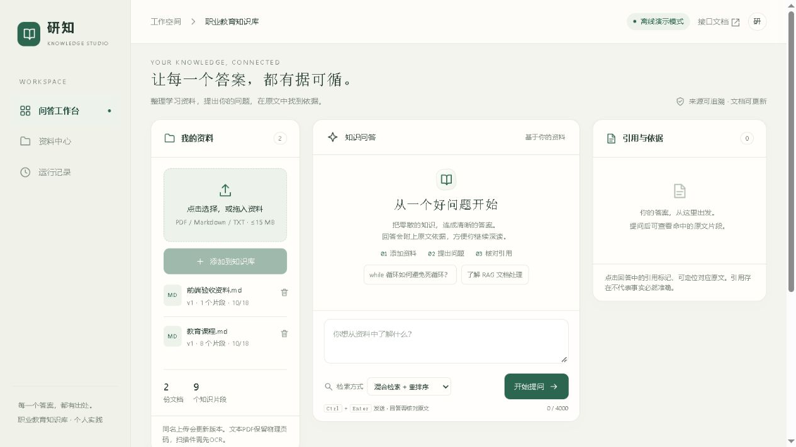
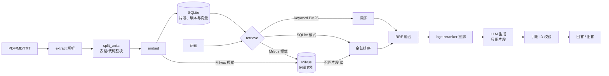

# 职业教育知识库RAG · 独立成品

## 30 秒了解

面向职业教育的**检索问答**：PDF/Markdown 解析 → 结构感知分块 → BM25 + bge 向量 → RRF → 重排 → 带引用回答。
引用 ID 必须来自本轮检索，越界或缺失直接拦截；检索不到依据时明确拒答，而不是硬编。



- 表格与代码块整块保留，纯文字分块与旧版一致
- 引用支持度只做词面重合提示，不冒充语义验证
- 同一问题的结果按文档版本缓存，文档增删自动失效




个人实践项目。曾在云端用 Docker Compose 验证 RAG 与 Milvus 的向量检索、引用、同名更新、删除和应用重启恢复，也做了浏览器验收。测试实例已释放，公开仓库可用自编样例离线复现。BGE 联调在本机运行模型并连接云端 Milvus，和云端哈希演示分开记录。

2026-11-07 修订：本地模型依赖缺失时自动退回哈希向量（不再让请求 500）；异步任务表加上限；页面右上角新增“访问口令”，设置 `APP_TOKEN` 后页面也能正常上传/删除；补仓库与打包规则（评测脚本随仓库发布，运行数据库不进包）；清理翻译腔注释。当前测试数为 **35 项**。

2026-10-20 为后端、前端、入口和测试补充中文注释，只解释行为与原因；阅读顺序见 docs/代码注释与阅读顺序.md。

2026-10-19流式体验更新：生成期间即时显示标题、列表、加粗、代码与完整引用，隐藏尚未完整到达的格式标记；完成后保留最终引用检查。Ctrl+F5刷新即可，见docs/流式即时排版_20261019.md。

2026-10-19修复概念汇总漏项：枚举问题补充同文档邻块并增加有界上下文，回答输出上限调整为3200 token；支持引用ID外围空格，未知ID仍拦截。Milvus原问题真实复测覆盖课件12个主要条目；刷新后重新提问即可。记录见docs/概念汇总漏项修复_20261019.md。

2026-10-19新增真实流式输出：生成过程逐步显示文字，完成后核对引用；异常或断线会清除未完成文本。Ctrl+F5刷新页面即可，无需重传资料。实现与实测边界见docs/流式输出_20261019.md。

2026-10-19曾按用户确认将LangChain课件163块重建为阿里云真实索引，原问题真实查询成功；这是本机历史验收记录，索引与课件不随源码发布，也不表示当前服务正在运行。运行启动真实模型.py使用真实模式，启动项目.py默认仍为离线。记录见docs/阿里云真实模式验收_20261019.md。

2026-10-19修复：离线摘录中的代码下标、数组、Markdown链接不再被误当非法引用而拦截。已有文件无需重新上传，停止并重新运行启动项目.py加载更新。记录见docs/上传课件查询修复_20261019.md；离线模式只摘录原文，不调用大模型总结。

2026-10-18前端更新为“研知”工作台：墨绿/暖白、资料—答案—引用布局，加入加载/错误状态、引用定位、拖入上传与反馈。设计及预览服务说明见docs/前端设计说明.md，截图在docs/界面预览；后端接口未更换。

此目录可单独复制、安装和启动，不引用另一个项目或原“项目成品”目录。默认数据在本目录runtime/app.db，端口8001；另一个项目的数据、页面与启动入口独立。

## 本次改造（2026-11-07）

- **结构感知分块**：表格与代码块整块保留，并补上章节名，避免横向表格被字符窗口切断；纯文字文档分块结果与旧版一致。
- **中文分词**：装了 jieba 就按词切（`向量数据库` 不再被拆成四个碎片），没装则自动退回单字+双字，行为不变。
- **检索评测**：`python evaluation/eval_metrics.py` 输出四种策略的 Recall@5 / MRR / 无答案误召回率，写入 `evaluation/metrics_report.json`。
- **并发与稳定性**：SQLite 开启 WAL 与 busy_timeout；模型调用对超时/5xx 自动重试一次。
- **写接口鉴权**：设置环境变量 `APP_TOKEN` 后，上传/删除需要 `X-API-Key` 头；未设置时保持本地开放。页面右上角“访问口令”填同一个值即可，口令只保存在本机浏览器。
- **检索缓存**：同一问题在文档未变时复用上次结果，文档增删后自动失效（`suite/cache.py`）。
- **引用支持度**：对每条引用做词面重合检查，输出 `citation_support`（弱引用列表），只做提示不做判定。
- **多轮对话**：前端自动生成会话号并随请求发送，服务端用 `turns` 表保存最近 3 轮作为上下文。
- **异步入库**：`POST /api/rag/documents/async` 返回 `task_id`，用 `GET /api/rag/tasks/{id}` 查进度，适合大 PDF。
- **注释整理**：删除逐行翻译式注释，只保留解释“为什么”的说明。
- **持续集成**：`.github/workflows/ci.yml` 跑单元测试 + 评测脚本。

### 本地模型（已接入）

- **Embedding**：`bge-base-zh-v1.5`（768 维）。设置 `EMBEDDING_MODEL_PATH` 指向模型目录才启用（默认不启用，走哈希向量），查询自动加 bge 指令前缀；
- **重排**：`bge-reranker-base`，设置 `RERANKER_MODEL_PATH` 后启用，替换原来的 LLM 重排，CPU 上 8 候选约 100–200ms；
- 换模型后跑一次 `python -X utf8 重建索引.py`（片段文本还在库里，不需要原始文件）；
- 换机器只需设置这两个环境变量；目录不存在或未装 `requirements-local.txt` 时自动退回哈希向量。
- 注意：切换是否启用本地模型等同于换模型，`documents.backend` 会变，旧资料必须跑一次 `python -X utf8 重建索引.py --data runtime` 才能继续检索到。
- 本地模型是**可选依赖**：需要 `python -m pip install -r requirements-local.txt`（含 sentence-transformers、jieba）。只放模型目录、不装依赖时程序会退回哈希向量，不会报错。

### 评测结果（11 篇文档 / 22 题，本地 bge）

| 策略 | Recall@5 | MRR | 无答案误召回 |
|---|---|---|---|
| keyword（BM25+分词） | 0.722 | 0.571 | 1.00 |
| vector（bge 向量） | 0.833 | 0.630 | 1.00 |
| hybrid（RRF） | 0.833 | 0.699 | 1.00 |
| hybrid_rerank（+ bge-reranker） | **0.944** | 0.627 | 1.00 |

“无答案误召回”是 4 道应拒答题目中仍检索到片段的占比（1.00 = 全部召回到内容，是否拒答由生成端的引用校验决定）。语料 11 篇里只有 2 篇课件，另 9 篇是项目文档作干扰项，属于自建小样本，数字不宜外推。

重排把 Recall@5 从 0.833 拉到 0.944，但 MRR 略降——重排会把部分正确页从第 1 位挪到第 2–3 位，换取更多正确页进入前 5。

复现（PowerShell；语料在 `runtime_lc2`，评测集在 `evaluation/pdf_cases.json`）：

```powershell
$env:APP_DATA='runtime_lc2'
$env:EMBEDDING_MODEL_PATH='./models/bge-base-zh-v1.5'
$env:RERANKER_MODEL_PATH='./models/bge-reranker-base'
python -X utf8 evaluation/eval_metrics.py --cases pdf_cases.json --no-ingest
```

不设 `APP_DATA` 时脚本默认用 `runtime_eval`（空库，结果全 0）；不设模型变量则退回哈希向量，数字会明显不同。

> 评测说明：仓库自带样例只有 1 篇文档，Recall 会接近 1.0，这组数字不能直接写进简历；导入多篇文档后重跑才有效。

## 设计取舍（面试常问）

- **为什么结构感知分块**：表格和代码被字符窗口切断后语义就废了，所以整块保留并补章节名；
  纯文字仍走 650/100 滑动窗口，与旧版结果一致。
- **为什么 RRF 而不是加权分数**：BM25 与余弦相似度量纲不同，直接相加没有可比性；
  RRF 只看名次，稳定、几乎不需要调参。
- **为什么重排后 Recall 升、MRR 略降仍采用**：目标是把正确页拉进前 5 供模型阅读，
  第 1 位的重要性低于覆盖面；这是有意取舍，不是指标退步。
- **为什么全量扫描而不是 ANN**：当前语料几百个片段，暴力余弦是毫秒级；超过 1 万块会显式报错，
  这是规模边界，而不是假装能撑生产。

## 启动

一键演示（临时库，不改动演示数据）：`python -X utf8 快速演示.py`；面试讲法与追问预案见 [docs/面试讲解.md](docs/面试讲解.md)。

在PyCharm中选择已安装依赖的项目解释器，分别运行本目录的`初始化样例.py`（首次一次）和`启动项目.py`，再打开 http://127.0.0.1:8001/ 。下面命令在本项目根目录执行，使用你自己的Python环境。

```powershell
python -m pip install -r requirements.txt
python -X utf8 初始化样例.py
python -X utf8 启动项目.py
```

默认demo离线演示，无模型消耗。干净机器需要Python3.12与`python -m pip install -r requirements.txt`；本机PDF私有依赖已各自复制到.deps。真实模式使用环境变量DASHSCOPE_API_KEY与APP_MODE=live；建议APP_DATA指定本项目自己的runtime_live，重新初始化后启动。不要把两个项目的APP_DATA设成同一位置。

已增加`启动真实模型.py`：固定使用本项目runtime_live和阿里云配置，不覆盖离线库。对已上传课件，可在明确允许其文本发送到阿里云后，运行`切换课件到真实索引.py --name "实际文件名.pdf"`，重建真实Embedding索引；会产生接口用量，重复且内容未变时不重复建索引。然后停止旧RAG进程并运行真实模型入口，右上角应显示“真实模型模式”。当前脚本已准备，不表示用户课件已外发或真实索引已经生成。不要把密钥写进源码或聊天。

```powershell
python 验证项目.py
# 可选真实调用，仅发送本目录样例和测试内容，有真实接口消耗
python 验证项目.py --live
# 需要在 Git 检出目录中运行，打包范围以 Git 跟踪文件为准
python 打包源码.py
```

验证记录在本项目 evaluation 目录。Docker 部署先执行 `docker compose up --build -d`，再执行 `docker compose exec projects python 初始化样例.py`。有真实模型调用或云端联调的记录属于对应测试环境。

## 云端 Milvus 联调

默认使用 SQLite。云端测试使用 Milvus Standalone 已创建的 `milvus` Docker 网络，
通过 `http://standalone:19530` 连接。SQLite 保存原文和版本，Milvus 负责向量召回。
演示集合 `education_rag_demo_1024` 对应 `demo_hash:1024`。切换 Embedding 模型时使用新集合。

在云服务器将新版解压到单独的目录，在该目录执行下列命令。新版监听服务器本机 `8011`，
Compose 项目名和数据卷独立于原 `8001` 展示版。

```bash
export RAG_HOST_PORT=8011
rag_milvus() {
  docker compose -p education-rag-milvus -f compose.yaml -f compose.milvus.yaml "$@"
}
rag_milvus --progress plain build --build-arg PIP_INDEX_URL=https://mirrors.aliyun.com/pypi/simple/ projects &&
rag_milvus up -d &&
rag_milvus exec projects python 初始化样例.py &&
curl -fsS --retry 5 --retry-all-errors http://127.0.0.1:8011/api/health
```

健康接口报告配置。再执行纯向量问答，从 `events` 中确认出现 `vector_search`、
`backend: milvus` 和非空 `chunk_ids`，并核对返回的来源章节。

```bash
curl -fsS http://127.0.0.1:8011/api/rag/ask \
  -H 'Content-Type: application/json' \
  -d '{"question":"同名文档内容改变后递增版本，在新解析与向量化成功后原子替换旧分块。","strategy":"vector"}' \
  | python3 -m json.tool --no-ensure-ascii
```

然后验证同名更新和删除。每次生成一个独立的测试文件名，便于和之前的测试区分。

```bash
check_dir=$(mktemp -d)
check_file="$check_dir/milvus-check-${check_dir##*.}.md"
printf '# 云端验收\n测试口令是青竹七号。\n' > "$check_file"
curl -fsS -F "file=@$check_file" http://127.0.0.1:8011/api/rag/documents

printf '# 云端验收\n测试口令是青竹九号。\n' > "$check_file"
curl -fsS -F "file=@$check_file" http://127.0.0.1:8011/api/rag/documents
```

确认第二次返回相同的 `id` 和 `version: 2`。将问答命令里的问题换成「测试口令是青竹九号。」验证新版引用。
再执行 `curl -fsS -X DELETE http://127.0.0.1:8011/api/rag/documents/实际文档ID`，
重复问答，来源中不应再有该文件。若接口返回 `milvus_cleanup_pending`，SQLite 已移除该文档，
远端清理会在下次向量检索时重试。原有 SQLite 分块会在首次向量检索时补建索引。
如果更换 Milvus 数据卷或重建远端数据库，请换一个新集合名再补建索引。

## 项目内容

- PDF/Markdown/TXT读取、页码或章节、分块、文档更新与删除。
- SQLite向量持久化、BM25/向量/RRF/重排序、回答引用、拒答、反馈和追踪。
- 本项目只提供RAG页面与接口，不含建单或Agent会话端点。
- `suite/core.py`基础设施，`suite/rag.py`检索问答，`suite/app.py`接口，`static`页面。
- 拆分后的固定评估保留原清单中教育相关40题（30有依据、10无答案），不是重新宣称真实准确率；原合并50题及真实记录仍在旧目录。

## 手动验证

1. 查询“while循环为什么更新变量”，展开来源与章节；问“课程学费多少钱”，预期资料不足。
2. 上传UTF-8 Markdown写明“测试口令是青竹七号”，查询并查看引用。
3. 同名文件改口令再上传，版本递增，查询依据应为新内容；删除后不应继续检索到旧片段。
4. 切换策略、提交反馈、打开执行记录；PDF页码为物理页，无文字页不做OCR。

## 拆分与验收边界

原合并目录未删除；使用SQLite在线backup读取来源，在新副本保留本项目数据。两份原始自编样例按项目归属分离，其他用户上传文档保留副本，不按内容猜测删除。Agent原会话/任务/工单若存在会随副本保留；浏览器端口改变后需手工粘贴原会话编号恢复。

历史云端验收覆盖了网页引用定位、反馈、拒答、文档增删改和应用重启后索引复用。本轮开源前复验使用本地自动化和公开样例。

展示版面向个人实践，默认用哈希向量与原文摘录。扫描件 OCR、完整用户认证和多人部署需要另行接入与验收。引用可以定位原文，回答是否得到原文支持仍需核对。
