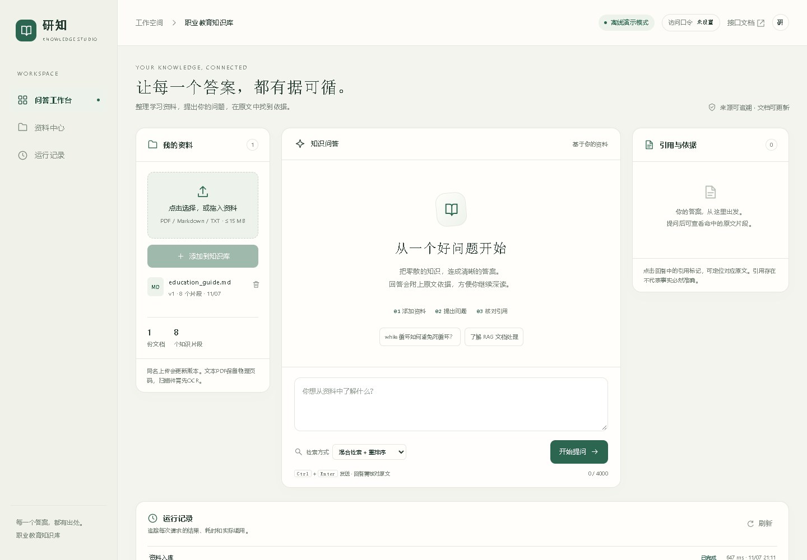

# 研知 · 教育知识库 RAG

面向教育资料的检索问答工作台。上传 PDF、Markdown 或 TXT 后，可以提问、查看答案引用，并定位到原文的页码或章节。同名更新和删除会同步维护索引。



## 功能

- 保留页码、章节和片段 ID，分块时尽量保留 Markdown 表格和代码块。
- 支持 BM25、向量检索、RRF 融合与候选重排。向量检索可以使用 SQLite 或 Milvus。
- 通过 SSE 返回问答进度和结果，引用定位到本次实际返回的来源。
- 支持文档版本更新、删除、反馈及执行记录。资料不足时给出明确提示。

## 快速启动

需要 Python 3.12。在仓库根目录运行下列命令。默认使用自编样例与 SQLite，离线模式返回资料摘录。

```bash
python -m pip install -r requirements.txt
python seed_demo.py
python serve.py
```

打开 [工作台](http://127.0.0.1:8001/rag) 或 [API 文档](http://127.0.0.1:8001/docs)。可先问「同名文档内容改变后，如何更新版本并处理旧分块？」，再点答案里的引用。

使用 Docker Compose 时执行：

```bash
docker compose up --build -d
docker compose exec projects python seed_demo.py
curl -fsS http://127.0.0.1:8001/api/health
```

容器将 SQLite 数据保存在 `rag-data` 数据卷。默认发布到服务器本机，避免把演示服务直接开放到公网。

## 配置

配置项见 [环境变量示例](.env.example)。Python 入口从进程环境读取配置。使用 Compose 时，可在仓库根目录配置本机的 `.env`。

| 配置项 | 用途 |
| --- | --- |
| `APP_MODE` | `demo` 使用离线摘录，`live` 启用模型生成 |
| `APP_DATA` | 本机数据目录，建议按运行模式隔离 |
| `DASHSCOPE_API_KEY`、`MODEL_BASE_URL`、`CHAT_MODEL` | 真实模式的模型服务配置 |
| `EMBEDDING_MODEL_PATH`、`RERANKER_MODEL_PATH` | 可选的本地模型目录，先安装 `requirements-local.txt` |
| `VECTOR_STORE` | `sqlite`（默认）或 `milvus` |
| `MILVUS_URI`、`MILVUS_COLLECTION` | Milvus 的连接地址与集合 |
| `APP_TOKEN` | 写接口访问口令，设置后在页面右上角填写同一值 |

如需真实模式，先在本机设置模型密钥和独立的 `APP_DATA`，再用相同环境运行初始化和服务。该模式会把所需文本发送给配置的模型服务，并产生相应调用费用。

```bash
python seed_demo.py
python serve.py --mode live
```

初始化真实模式的索引前，将 `APP_MODE` 同样设为 `live`。向量维度和 Embedding 模型发生变化时，使用独立集合并重建索引。

### Milvus 模式

先启动 [Milvus Standalone](https://milvus.io/docs/install_standalone-docker-compose.md)，确认服务名为 `standalone`，并且它连接到 Docker 网络 `milvus`。然后在项目目录启动独立的 RAG 实例：

```bash
RAG_HOST_PORT=8011 docker compose -p education-rag-milvus -f compose.yaml -f compose.milvus.yaml up --build -d
RAG_HOST_PORT=8011 docker compose -p education-rag-milvus -f compose.yaml -f compose.milvus.yaml exec projects python seed_demo.py
```

打开 [Milvus 版工作台](http://127.0.0.1:8011/rag)。切换到纯向量策略后，运行记录里的 `vector_search` 会显示实际召回的片段 ID。该配置使用 1024 维离线向量。BGE 768 维模型已通过连接 Milvus 的隔离联调，可按本地模型配置另建集合。

## 验证与维护

```bash
python -m pytest tests -q
node tests/test_stream_client.js
node tests/test_stream_format.js
python -X utf8 -m scripts.demo
python -X utf8 evaluation/eval_metrics.py
```

评测使用公开的 `evaluation/retrieval_cases.json` 和自编样例，输出报告留在本机。若已设置 `APP_DATA`，评测会使用该数据目录。需要隔离时先改为新的空目录。

| 入口 | 用途 |
| --- | --- |
| `python -X utf8 -m scripts.verify` | 在临时数据目录完成回归并输出验收报告 |
| `python -X utf8 -m scripts.rebuild_index --data ./runtime` | 按当前配置重建已有片段向量 |
| `python -X utf8 -m scripts.migrate_document_index --help` | 迁移指定文档索引 |
| `python -m scripts.package_source` | 从 Git 检出目录打包已跟踪的源码 |

## 项目结构

- `suite/` 保存 HTTP 接口、文档处理、检索和模型适配。
- `static/` 保存工作台与 SSE 客户端。
- `samples/`、`tests/`、`evaluation/` 保存自编样例、测试和评测入口。
- [架构与数据流](docs/architecture.md) 说明 SQLite、Milvus、检索流程和更新一致性。

PDF 提取依赖文本层。使用扫描件时需要另行 OCR。当前访问口令适用于单用户环境的写接口保护，多用户使用需要独立的身份和资料权限控制。仓库采用 [MIT 许可证](LICENSE)。
