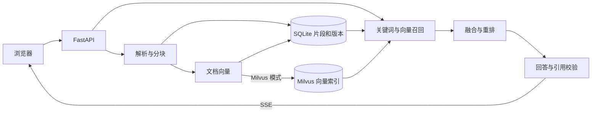

# 架构与数据流

## 组件

| 层 | 文件 | 职责 |
| --- | --- | --- |
| Web | `static/app.js`、`static/stream.js` | 上传、提问、读取 SSE、定位引用 |
| HTTP | `suite/app.py` | 文档管理、问答、反馈、执行追踪 |
| 业务 | `suite/rag.py` | 文件解析与分块、检索、重排、引用校验 |
| 存储与模型 | `suite/core.py`、`suite/milvus_store.py` | SQLite、Embedding 与生成接口、Milvus 向量索引 |

## 文档与索引一致性

SQLite 保存文档版本、原文、页码或章节以及片段 ID。Milvus 使用相同的片段 ID 做向量召回，应用再读取当前版本的正文。更新先生成并写入新向量，再提交文档新版本。旧向量清理失败时会留下待处理记录，后续检索可重试。删除或失效的片段不会作为当前引用返回。

检索支持关键词、纯向量、混合与混合重排。重排仅处理候选。页面保留原文与版本，引用校验保证引用 ID 来自本次证据集合，语义支持仍需核对原文。
